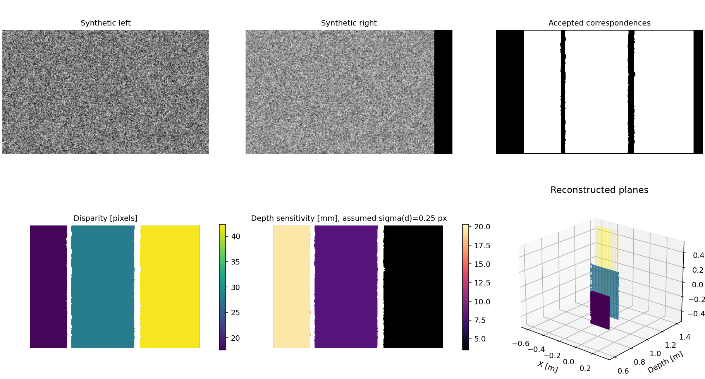
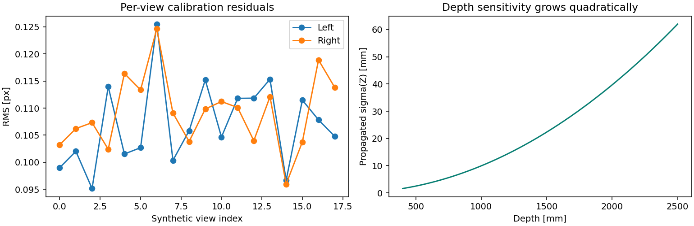
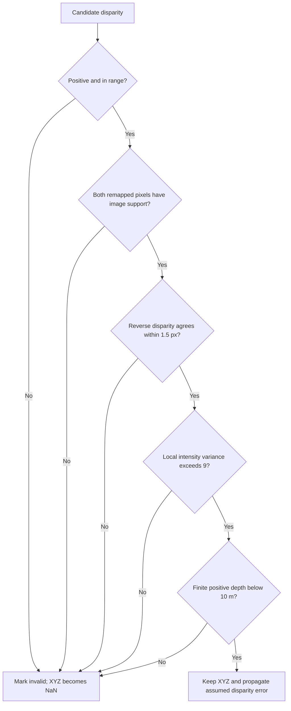

# Stereometry

**Stereo depth with an error budget, not just a point cloud.**


Calibrate paired cameras, measure sparse correspondences, reconstruct dense depth,
and inspect which pixels survived the geometric checks. Stereometry connects the
complete stereo workflow to an explicit question: how sensitive is this depth to
a small disparity error?



**All benchmark imagery on this page is synthetic.** The raw calibration sequences
from the original hardware sessions are not part of this repository, so nothing
here pretends that a generated rig is a calibrated real camera.

## Capabilities

| Stage | Delivered evidence |
| --- | --- |
| Paired checkerboard calibration | Intrinsics, five distortion terms, extrinsics, baseline, per-view residuals and rejected filenames |
| Sparse triangulation | XYZ in millimeters, reprojection errors, positive-depth validation and two-point distances |
| Plane measurement | Raw pixels intersected with a posed checkerboard plane |
| Dense SGBM reconstruction | Rectification, reverse-match consistency, texture/support masks and finite positive depth |
| Depth sensitivity | Propagated depth sigma under an explicitly stated disparity sigma |
| Export | JSON calibration, NPZ arrays, validity PNG, anaglyph and meter-scale PLY |

## Quick Start

Python 3.10+. Create and activate a virtual environment, then run from this root:

```bash
python -m pip install -e ".[dev]"
python -m pytest
python examples/reproduce.py
```

The demo writes generated frames, rendered checkerboard captures and reports into
`outputs/synthetic/`, plus the README figures. No camera, GPU, SDK, model weights or
external dataset is needed. Existing generated outputs are overwritten on rerun.
Every CLI stage then runs on the generated files:

```bash
stereometry calibrate outputs/synthetic/captures/left outputs/synthetic/captures/right --columns 9 --rows 6 --square-mm 18 --out outputs/calibration
stereometry depth outputs/synthetic/left.png outputs/synthetic/right.png --rig outputs/synthetic/rectified_rig.json --out outputs/replay
```

## Benchmark



The committed [result ledger](docs/figures/results.json) is generated by the same
code as the figures. Three seeded fixtures with known ground truth:

| Fixture | What it exercises | Result |
| --- | --- | --- |
| 18 projected board views, lens distortion, 0.08 px corner noise | calibration maths | 0.112 px stereo RMS; baseline 62.97 vs 63.00 mm; focal 702.5 vs 700.0 px |
| 12 rendered, anti-aliased checkerboard image pairs | detection, pairing, calibration, CLI | 0 of 12 pairs rejected; 0.045 px RMS; baseline 62.92 vs 63.00 mm; focal 617.2 vs 620.0 px |
| Three textured planes at 600, 900 and 1400 mm | rectification, SGBM, validity gates, reprojection | 76 % valid pixels; plane medians 600 / 900 / 1400 mm; propagated sigma 3.6 / 8.0 / 19.4 mm |

The last column of the dense row shows the quadratic error budget at work: with
the same 0.25 px disparity uncertainty, depth sensitivity is 5x larger at 1.4 m
than at 0.6 m. Exact plane medians are expected for an integer-shift fixture; they
are not evidence of zero error on natural scenes. The rendered images have no lens
distortion and the dense scene uses known rectification, so none of these fixtures
measures real-sensor accuracy.

## Real Camera Workflow

1. Capture 15-25 stationary checkerboard poses across the image, at several distances
   and tilts. Keep focus, resolution and the rig mechanically fixed.
2. Save paired PNGs under `captures/left/` and `captures/right/` with identical names.
   Pairs must represent the same exposure and the same physical board orientation.
3. Measure square size. `--columns` and `--rows` count **inner corners**, not squares.
4. Inspect per-view residuals, target coverage, decoded ordering and an independent
   known distance. A low training RMS does not establish metric accuracy.

```bash
stereometry calibrate captures/left captures/right --columns 9 --rows 6 --square-mm 18 --out outputs/calibration
stereometry depth scene/left.png scene/right.png --rig outputs/calibration/rig.json --num-disparities 128 --out outputs/scene
```

The detector skips pairs with missing boards but records their filenames. It
requires at least six accepted views; six is a software minimum, not a recommended
capture protocol. Symmetric checkerboards may have ambiguous ordering. Inspect it
before relying on the scale. The model is pinhole plus `k1,k2,p1,p2,k3`, not fisheye.

Sparse correspondences are an NPZ containing equal `left_xy` and `right_xy` arrays:

```python
import numpy as np

np.savez(
    "points.npz",
    left_xy=[[260.0, 130.0], [300.0, 130.0]],
    right_xy=[[232.0, 130.0], [272.0, 130.0]],
)
```

```bash
stereometry measure points.npz --rig outputs/synthetic/rectified_rig.json --out outputs/measurement.json
```

Both points come back valid at 900 mm depth with zero reprojection error, 90.0 mm
apart - the values the synthetic rig was built to produce.

These example pixels belong to the synthetic rig. Real measurements must use
coordinates selected from the raw images of your calibrated pair. Do not mix raw,
undistorted, cropped and rectified pixel coordinates.

## How It Connects

```mermaid
flowchart LR
    Camera[Side-by-side camera stream] --> Split[Split one exposure into left and right]
    Split --> Pairs[Paired checkerboard PNGs]
    Pairs --> Detect[Detect corresponding inner corners]
    Detect --> Mono[Calibrate both cameras]
    Mono --> Stereo[Estimate relative pose]
    Stereo --> Model[Unit-tagged rig JSON and diagnostics]
    Scene[Raw scene pair] --> Rectify[Undistort and rectify]
    Model --> Rectify
    Rectify --> SGM[SGBM in both directions]
    SGM --> Gates[Support texture and consistency gates]
    Gates --> XYZ[Reproject valid pixels]
    XYZ --> Artifacts[NPZ mask anaglyph and PLY]
    Model --> Sparse[Undistort sparse correspondences]
    Sparse --> Triangulate[Triangulate and validate reprojection]
    Triangulate --> Measurement[XYZ and distance in mm]
```





## Units and Sensitivity

For a rectified horizontal rig, $Z=fB/d$ and
$\sigma_Z \approx fB\sigma_d/d^2$. Focal length is in pixels, baseline and XYZ are
in millimeters. PLY output converts to meters. Coordinates follow the rectified
left camera: x right, y down, z forward. Sparse XYZ follows the original left camera.

The default assumption is `sigma_d = 0.25 px`. It is a sensitivity model, not an
estimated confidence interval. Calibration, board scale, blur, synchronization,
matching bias and occlusion are not captured by that term. Depth sensitivity grows
quadratically with distance, even when a disparity image looks equally detailed.

## Layout

```text
src/stereometry/    rig, calibration, dense depth, synthetic fixtures, reports and CLI
tests/             known geometry, corner- and image-level calibration, dense planes, CLI
examples/          repeatable synthetic benchmark
docs/              calibration protocol, diagrams, figures and result ledger
matlab/            eight adapted hardware/calibration/measurement functions
.github/workflows/ Python tests, lint, demo and package build
```

## Scope and Limits

Dense matching requires a horizontal rig, the right camera physically to the right,
and images at calibration resolution. Reflective, transparent, moving or untextured
objects can defeat matching. The validity mask is not proof of correctness.
Read the [calibration protocol](docs/calibration.md) and
[MATLAB workflow map](matlab/README.md) before hardware use. MATLAB and hardware
execution remain unverified in this environment.

Project 3 in the series: camera-noise-characterization measures image formation,
Featureforge extracts features, and Stereometry turns calibrated observations into
spatial measurements.

## License

[MIT](LICENSE)